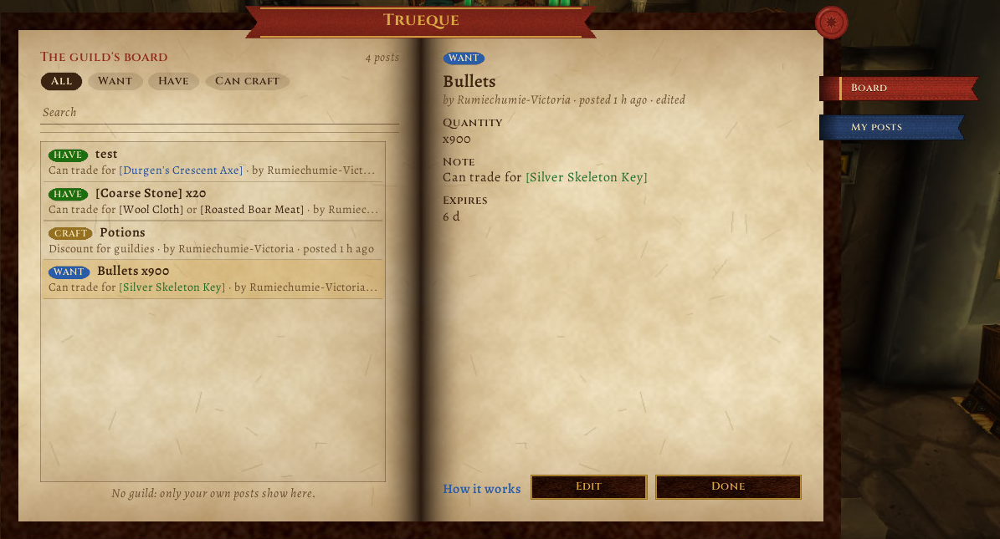

# Trueque

Un tablón para tu guild en **WoW Forever**: qué **buscás**, qué **tenés** y qué **podés hacer**. Todos los de la guild con el addon ven el mismo tablón, y un clic le susurra al autor con una línea ya escrita ("Trueque: tengo lo que buscás: [Rollo de lino]"). Si alguien tiene lo que vos buscás, te avisa.

Es la pareja de [Taller](https://github.com/JoseArgento/taller): lo que te falta para una receta se publica con un botón.

[Read in English](README.en.md)



**Contenido**

- [Cómo se usa](#cómo-se-usa)
- [Qué manda y qué recibe](#qué-manda-y-qué-recibe)
- [Con Taller](#con-taller)
- [Instalar](#instalar)
- [Cómo se probó](#cómo-se-probó)
- [Desarrollo](#desarrollo)
- [Apoyar](#apoyar)

## Cómo se usa

Se abre con `/trueque`, con el **botón redondo del minimapa** (clic derecho: mis avisos; se arrastra alrededor del minimapa y `/trueque minimapa off` lo esconde; `/trueque minimapa juntar on` junta los botones de toda la familia en uno solo con menú), con el atajo de teclado o desde el compartimento de addons. La ventana es un **libro de pergamino** (la piel [Pergamino](https://github.com/JoseArgento/pergamino), la misma de Bitácora y los demás addons) con dos marcadores:

- **Tablón.** A la izquierda, los avisos de la guild, los más nuevos arriba, con filtros (Todos / Quiero / Tengo / Puedo hacer) y un buscador. A la derecha, el aviso elegido: el ítem, quién lo publicó, la cantidad, su nota, cuándo vence, y un botón: **"Lo tengo"** si alguien busca algo, **"Me interesa"** si alguien ofrece algo o puede hacerlo. El botón le susurra al autor una línea ya escrita, nada más. Si es un aviso tuyo, hay **"Cambiar"** y **"Ya está"**; cerrar pregunta antes.
- **Mis avisos.** Elegís qué es (Quiero, Tengo, Puedo hacer), pegás un ítem o una receta con **Shift-clic** en el campo (o escribís un nombre), cuántos (vacío = sin límite), una nota corta (con Shift-clic también podés meter ítems adentro de la nota: "lo cambio por [Paño de lana]"), y **Publicar**. A la derecha, tus avisos vigentes: un clic lo carga en el formulario para cambiarlo (el botón pasa a **"Guardar cambios"**), el clic derecho lo cierra, después de preguntar.

Al pasar el mouse por un aviso con un ítem o una receta se ve el tooltip del juego, como en el chat; con Shift-clic el link va a la caja del chat.

Cada aviso **vence a los 7 días** (`/trueque dias N`, de 1 a 30) o cuando lo cerrás. Un jugador tiene hasta 20 avisos a la vez.

**Cruces.** Si publicás "Quiero X" y alguien de la guild tiene "Tengo X" o "Puedo hacer X", el aviso lleva la etiqueta **"hay uno"** y el chat te lo dice una vez: "Trueque: Cruce: Ana lo tiene: [Rollo de lino]". Al revés también: si ofrecés algo que otro busca.

`/trueque idioma es|en|auto` elige el idioma (sirve si jugás con el cliente en inglés). `/trueque errores` muestra los errores propios del addon, para copiarlos en un issue.

## Qué manda y qué recibe

Los avisos viajan por **mensajes de addon** en el canal de guild (prefijo `Trueque1`): al entrar y al abrir el tablón, el addon pregunta "¿quién tiene avisos?" y cada uno responde con los suyos; al publicar o cerrar manda solo ese cambio. Cada mensaje lleva el tipo, la referencia del ítem (`item:2996`) y su nombre, la cantidad, la nota, la fecha y el vencimiento: menos de 250 bytes.

- **Nada de lo que llega se ejecuta.** Los campos se leen como texto. Una referencia se usa como link solo si tiene forma de link (`item:`, `enchant:`, `trade:`); cualquier otra cosa queda como texto plano. Un jugador solo puede publicar, cambiar o cerrar sus propios avisos; se guardan hasta 20 por jugador.
- **Nunca escribe en el chat por su cuenta.** Los susurros de "Lo tengo" y "Me interesa" salen solo cuando hacés clic.
- Los avisos que recibís se guardan por guild (`TruequeDB`), así el tablón está lleno al entrar, y lo vencido se borra solo.
- Con una **cuenta de prueba**, Forever no deja mandar mensajes de addon: ves el tablón de la guild, pero tus avisos se quedan con vos. El addon te lo dice una vez.

## Con Taller

Si está [Taller](https://github.com/JoseArgento/taller), en "Mis avisos" aparece el botón **"Publicar lo que me falta"**: lee la lista de compras de Taller y publica un "Quiero" por cada material que falta, con la cantidad. Lo que ya publicaste no se repite. Si Taller no está, el botón no aparece.

## Instalar

Copiá la carpeta `Trueque` a `Interface\AddOns\`, dentro de la carpeta de Forever del juego (`World of Warcraft\_forever_\Interface\AddOns`). Para que la guild vea tus avisos, los demás también tienen que tenerlo.

## Cómo se probó

**Probado:**
- ✅ Cada función que usa existe en Forever 1.60.1: `tools/check_api.py` contra los dumps de [Ketho/BlizzardInterfaceResources](https://github.com/Ketho/BlizzardInterfaceResources) y la UI de [Gethe/wow-ui-source](https://github.com/Gethe/wow-ui-source), rama `forever`.
- ✅ [forever-lint](https://github.com/JoseArgento/forever-lint) solo con la nota FL012 (cuentas de prueba, manejada); Addon Sentry: "Sin señales de riesgo" (lo único que puede hacer es susurrar, y es desde el clic).
- ✅ **52 tests** en Lua 5.1 (el Lua de WoW) con varios jugadores de la misma guild pasándose los mensajes: publicar, cerrar y vencer; preguntar y responder; que nadie pueda cerrar o pisar el aviso de otro; mensajes rotos y hostiles descartados o reducidos a texto; `|` y `%` en los textos; el tope de 20 y los 250 bytes; los cruces y el aviso una sola vez; que el susurro salga solo del clic; cuentas de prueba; sin guild; idioma; el libro y el formulario; Taller presente, ausente y roto; los errores propios guardados.

**En el cliente** (6/11, sin guild): el libro, los chips, el buscador, publicar, cambiar y cerrar, el Shift-clic en el campo y en la nota (sin partir la pila), los links con los colores de pergamino, el tooltip del juego sobre los links de la nota y el botón del minimapa.

**Todavía sin ver ⏳:**
- Una guild entera con el addon a la vez: los mensajes, el "hay uno" y el susurro (`C_ChatInfo.SendChatMessage` con `WHISPER` a "Nombre-Reino" tal como llega en `CHAT_MSG_ADDON`) se probaron con varios clientes simulados.
- "Publicar lo que me falta" con Taller instalado.

**Si algo falla:** `/trueque errores` muestra el último error del addon (se guardan los últimos 10, sin popups) para copiarlo en un issue de GitHub.

## Desarrollo

```bash
pip install pytest lupa
pytest
python tools/check_api.py --bir ../BlizzardInterfaceResources --ui ../wow-ui-source --scanner ../addon-sentry/src
python tools/make_icon.py   # redibuja Trueque/Media/icon.tga
```

`Bindings.xml` no va en el TOC: el juego lo carga solo. Un tag `v*` empaqueta el addon con el packager de BigWigs. La piel está copiada en `Trueque/Libs/Pergamino` (`tools/vendor.sh` del repo pergamino la actualiza).

Sin relación con Blizzard Entertainment. World of Warcraft es marca registrada de Blizzard Entertainment, Inc. Licencia MIT.

## Apoyar

Todo esto es gratis y de código abierto, y va a seguir así: no hay funciones pagas ni nada antes para quien aporta. Si te sirvió y querés bancar el tiempo de mantenerlo, podés hacerlo en [Patreon](https://www.patreon.com/cw/DoblePupi). Gracias ♥
